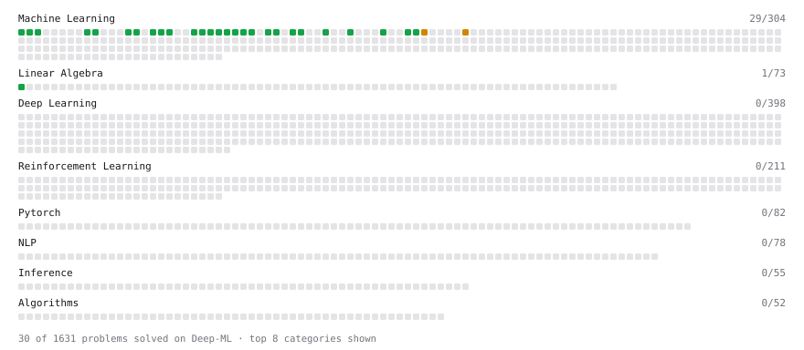

# Deep-ML

My machine learning practice from [Deep-ML](https://www.deep-ml.com). Every solution here was written by hand.

**50** solved · 48 problems · 0 labs · 2 math

[**Browse the interactive portfolio**](https://3Androuk.github.io/deep-ml/) to replay this filling in over time.

## Problems

| | Difficulty | Solved | |
| --- | --- | --- | --- |
| [Batch Iterator for Dataset](https://www.deep-ml.com/problems/30) | easy | 2026-10-20 | [solution](problems/0030-batch-iterator-for-dataset) |
| [Binary Classification with Logistic Regression](https://www.deep-ml.com/problems/104) | easy | 2026-10-22 | [solution](problems/0104-binary-classification-with-logistic-regression) |
| [Calculate Accuracy Score](https://www.deep-ml.com/problems/36) | easy | 2026-10-20 | [solution](problems/0036-calculate-accuracy-score) |
| [Calculate Dice Score for Classification](https://www.deep-ml.com/problems/73) | easy | 2026-10-22 | [solution](problems/0073-calculate-dice-score-for-classification) |
| [Calculate F1 Score from Predicted and True Labels](https://www.deep-ml.com/problems/91) | easy | 2026-10-22 | [solution](problems/0091-calculate-f1-score-from-predicted-and-true-labels) |
| [Calculate Jaccard Index for Binary Classification](https://www.deep-ml.com/problems/72) | easy | 2026-10-22 | [solution](problems/0072-calculate-jaccard-index-for-binary-classification) |
| [Calculate Mean Absolute Error (MAE)](https://www.deep-ml.com/problems/93) | easy | 2026-10-22 | [solution](problems/0093-calculate-mean-absolute-error-mae) |
| [Calculate R-squared for Regression Analysis](https://www.deep-ml.com/problems/69) | easy | 2026-10-22 | [solution](problems/0069-calculate-r-squared-for-regression-analysis) |
| [Calculate Root Mean Square Error (RMSE)](https://www.deep-ml.com/problems/71) | easy | 2026-10-22 | [solution](problems/0071-calculate-root-mean-square-error-rmse) |
| [Calculate SVM Margin Width](https://www.deep-ml.com/problems/282) | easy | 2026-10-26 | [solution](problems/0282-calculate-svm-margin-width) |
| [Compiling Functions with jax.jit](https://www.deep-ml.com/problems/1327) | easy | 2026-10-27 | [solution](problems/1327-compiling-functions-with-jax-jit) |
| [Derivative of a Polynomial](https://www.deep-ml.com/problems/116) | easy | 2026-10-25 | [solution](problems/0116-derivative-of-a-polynomial) |
| [Detect Overfitting or Underfitting](https://www.deep-ml.com/problems/86) | easy | 2026-10-22 | [solution](problems/0086-detect-overfitting-or-underfitting) |
| [Early Stopping Based on Validation Loss Plateau](https://www.deep-ml.com/problems/199) | easy | 2026-10-26 | [solution](problems/0199-early-stopping-based-on-validation-loss-plateau) |
| [ExponentialLR Learning Rate Scheduler](https://www.deep-ml.com/problems/154) | easy | 2026-10-24 | [solution](problems/0154-exponentiallr-learning-rate-scheduler) |
| [Feature Scaling Implementation](https://www.deep-ml.com/problems/16) | easy | 2026-10-20 | [solution](problems/0016-feature-scaling-implementation) |
| [Generate a Confusion Matrix for Binary Classification](https://www.deep-ml.com/problems/75) | easy | 2026-10-22 | [solution](problems/0075-generate-a-confusion-matrix-for-binary-classification) |
| [Gradient Checkpointing](https://www.deep-ml.com/problems/188) | easy | 2026-10-26 | [solution](problems/0188-gradient-checkpointing) |
| [Handle Missing Data in pandas (dropna/fillna)](https://www.deep-ml.com/problems/1128) | easy | 2026-10-31 | [solution](problems/1128-handle-missing-data-in-pandas-dropna-fillna) |
| [Immutable Arrays: Functional Updates with .at](https://www.deep-ml.com/problems/1324) | easy | 2026-10-27 | [solution](problems/1324-immutable-arrays-functional-updates-with-at) |
| [Implement Early Stopping Based on Validation Loss](https://www.deep-ml.com/problems/135) | easy | 2026-10-23 | [solution](problems/0135-implement-early-stopping-based-on-validation-loss) |
| [Implement F-Score Calculation for Binary Classification](https://www.deep-ml.com/problems/61) | easy | 2026-10-21 | [solution](problems/0061-implement-f-score-calculation-for-binary-classification) |
| [Implement Gini Impurity Calculation for a Set of Classes](https://www.deep-ml.com/problems/64) | easy | 2026-10-21 | [solution](problems/0064-implement-gini-impurity-calculation-for-a-set-of-classes) |
| [Implement Polynomial Kernel Function](https://www.deep-ml.com/problems/281) | easy | 2026-10-25 | [solution](problems/0281-implement-polynomial-kernel-function) |
| [Implement Precision Metric](https://www.deep-ml.com/problems/46) | easy | 2026-10-21 | [solution](problems/0046-implement-precision-metric) |
| [Implement Recall Metric in Binary Classification](https://www.deep-ml.com/problems/52) | easy | 2026-10-21 | [solution](problems/0052-implement-recall-metric-in-binary-classification) |
| [Implement Ridge Regression Loss Function](https://www.deep-ml.com/problems/43) | easy | 2026-10-19 | [solution](problems/0043-implement-ridge-regression-loss-function) |
| [Linear Kernel Function](https://www.deep-ml.com/problems/45) | easy | 2026-10-20 | [solution](problems/0045-linear-kernel-function) |
| [Linear Regression Using Gradient Descent](https://www.deep-ml.com/problems/15) | easy | 2026-10-20 | [solution](problems/0015-linear-regression-using-gradient-descent) |
| [Linear Regression Using Normal Equation](https://www.deep-ml.com/problems/14) | easy | 2026-10-19 | [solution](problems/0014-linear-regression-using-normal-equation) |
| [Matrix-Vector Dot Product](https://www.deep-ml.com/problems/1) | easy | 2026-10-19 | [solution](problems/0001-matrix-vector-dot-product) |
| [Measure Disorder in Apple Colors](https://www.deep-ml.com/problems/108) | easy | 2026-10-23 | [solution](problems/0108-measure-disorder-in-apple-colors) |
| [One-Hot Encoding of Nominal Values](https://www.deep-ml.com/problems/34) | easy | 2026-10-20 | [solution](problems/0034-one-hot-encoding-of-nominal-values) |
| [Random Shuffle of Dataset](https://www.deep-ml.com/problems/29) | easy | 2026-10-20 | [solution](problems/0029-random-shuffle-of-dataset) |
| [ReLU with JAX Arrays](https://www.deep-ml.com/problems/1323) | easy | 2026-10-27 | [solution](problems/1323-relu-with-jax-arrays) |
| [Shift and Scale Array to Target Range](https://www.deep-ml.com/problems/141) | easy | 2026-10-23 | [solution](problems/0141-shift-and-scale-array-to-target-range) |
| [StepLR Learning Rate Scheduler](https://www.deep-ml.com/problems/153) | easy | 2026-10-24 | [solution](problems/0153-steplr-learning-rate-scheduler) |
| [Your First Gradient with jax.grad](https://www.deep-ml.com/problems/1325) | easy | 2026-10-27 | [solution](problems/1325-your-first-gradient-with-jax-grad) |
| [Clean a Messy Dataset: Dedup, Standardize, Impute](https://www.deep-ml.com/problems/1131) | medium | 2026-10-31 | [solution](problems/1131-clean-a-messy-dataset-dedup-standardize-impute) |
| [CosineAnnealingLR Learning Rate Scheduler](https://www.deep-ml.com/problems/155) | medium | 2026-10-24 | [solution](problems/0155-cosineannealinglr-learning-rate-scheduler) |
| [Find Captain Redbeard's Hidden Treasure](https://www.deep-ml.com/problems/127) | medium | 2026-10-25 | [solution](problems/0127-find-captain-redbeard-s-hidden-treasure) |
| [Implement the Huber Loss Function](https://www.deep-ml.com/problems/192) | medium | 2026-10-19 | [solution](problems/0192-implement-the-huber-loss-function) |
| [K-Means Clustering](https://www.deep-ml.com/problems/17) | medium | 2026-10-26 | [solution](problems/0017-k-means-clustering) |
| [Linear Regression - Power Grid Optimization](https://www.deep-ml.com/problems/92) | medium | 2026-10-26 | [solution](problems/0092-linear-regression-power-grid-optimization) |
| [Merge Multiple DataFrames](https://www.deep-ml.com/problems/1129) | medium | 2026-10-31 | [solution](problems/1129-merge-multiple-dataframes) |
| [Multi-Parameter Gradients with argnums](https://www.deep-ml.com/problems/1326) | medium | 2026-10-27 | [solution](problems/1326-multi-parameter-gradients-with-argnums) |
| [Principal Component Analysis (PCA) Implementation](https://www.deep-ml.com/problems/19) | medium | 2026-10-27 | [solution](problems/0019-principal-component-analysis-pca-implementation) |
| [Vectorizing with jax.vmap](https://www.deep-ml.com/problems/1328) | medium | 2026-10-27 | [solution](problems/1328-vectorizing-with-jax-vmap) |

## Math

| | Difficulty | Solved | |
| --- | --- | --- | --- |
| [Matrix Basics](https://www.deep-ml.com/math-problems/9) | easy | 2026-10-19 | [solution](math/0009-matrix-basics) |
| [Vector Operations](https://www.deep-ml.com/math-problems/7) | easy | 2026-10-19 | [solution](math/0007-vector-operations) |

---

_This file is regenerated by Deep-ML on every push._
